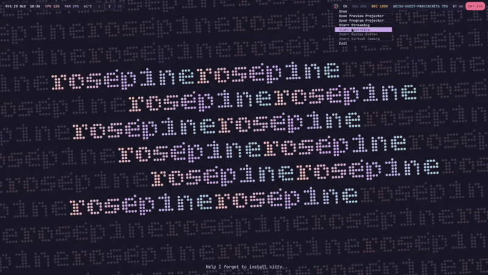

# dotfiles

Arch Linux + Hyprland, rose-pine throughout, TUI-first. Managed with GNU Stow.

It tries to stay as **universal** as possible. Anything that only applies to one
machine is either harmless on the other (touchpad config with no touchpad) or
falls back cleanly (the monitor catch-all with `mode = "preferred"`).



---

## Layout

Each top-level directory is a stow **package** whose interior mirrors `$HOME`:

```
foot/.config/foot/foot.ini   ->   ~/.config/foot/foot.ini
home/.zshrc                  ->   ~/.zshrc
bin/.local/bin/network-menu  ->   ~/.local/bin/network-menu
```

| package | holds |
|---|---|
| `hypr` | hyprland (lua), hypridle, hyprlock, hyprpaper, hyprlauncher, hyprtoolkit, hyprqt6engine |
| `home` | `.zshrc`, `.zshenv` |
| `foot` `starship` `bat` `btop` `yazi` `mako` `waybar` `mpd` `nvim` | per-program config |
| `bin` | `network-menu` — nmcli + hyprlauncher, replaces networkmanager-dmenu |
| `xdg` | `mimeapps.list`, `.desktop` files, portal routing |
| `termfilechooser` | yazi as the system file picker |
| `gtk` | GTK3/GTK4 `settings.ini` |
| `heroic-themes` | Heroic's custom CSS |

---

## Install

```bash
git clone <remote> ~/dotfiles && cd ~/dotfiles
./install.sh            # packages, dirs, stow, post-install, then prints manual steps
./install.sh manual     # reprint the manual steps
```

Stages run individually: `packages`, `dirs`, `stow`, `post`, `services`, `manual`.

`services` is deliberately excluded from `all`, and greetd is excluded from
`services` — a broken greeter means no graphical login.

For the OS install underneath this (partitioning, btrfs subvolumes, limine,
snapper, zram) see **arch-install.md**.

---

## Hand-written scripts (`bin/`)

Everything else in this repo is configuration for software someone else wrote.
These are programs **written for this setup**, and they have no upstream — if
they are lost, they are gone. Treat them as the most valuable files here.

### `network-menu`

Lists NetworkManager connections and wifi networks, pipes them through
`hyprlauncher --dmenu`, and acts on the selection with `nmcli`. Bound to
`SUPER + N`.

It exists because **networkmanager-dmenu does not work with hyprlauncher**. That
script carries a hardcoded table of supported launchers — bemenu, dmenu, fuzzel,
rofi, tofi, walker, wmenu, wofi — and appends per-launcher prompt flags by
binary name. hyprlauncher is not in it, so autodetection fell through to a
binary called `dmenu` that does not exist here (`FileNotFoundError: 'dmenu'`),
and even with a correct `config.ini` naming hyprlauncher explicitly, the menu
came back empty with no error. Rather than debug someone else's Python, this
does the same job in ~60 lines where every step is visible.

**Known limitation:** the passphrase prompt for a **new** wifi network pipes an
empty list to the launcher and reads what you type, with **no masking**. For a
network you have not joined before, use `nmcli device wifi connect SSID --ask`
in a terminal instead.

### Adding another

Scripts go in `bin/.local/bin/`, `chmod +x` (git tracks the exec bit, so it
survives a clone). `~/.local/bin` is put on `PATH` by `conf/environment.lua` via
`hl.env` — **not** by `.zshrc`, because Hyprland keybinds, waybar click actions
and systemd user services never read `.zshrc`.

---

## What is NOT in here, and why

**Anything reproducible from a package.** The GTK4 stylesheet is a symlink into
`/usr/share/themes/`, so `install.sh post` recreates it rather than tracking a
dangling link. Stow refuses to stow a symlink anyway.

**Anything a program writes.** MPD's `database` and `sticker.sql`, yazi and btop
state. Stow folds directories, so a stowed `~/.config/mpd` means MPD writes
*into the repo* — those paths are explicitly ignored.

**nwg-look's output.** It writes `gtk-3.0/settings.ini` (tracked) *and* a binary
dconf database (not trackable). Half-tracked state is worse than none, so
running nwg-look is a manual step.

---

## Maintenance

```bash
git pull
stow --target=$HOME --restow */     # --restow prunes links to deleted files
```

Adding a package:

```bash
mkdir -p newpkg/.config/newpkg
mv ~/.config/newpkg/config newpkg/.config/newpkg/
stow newpkg
echo '!newpkg/**' >> .gitignore
```

Checks worth running before a commit:

```bash
find . -path ./.git -prune -o -type l -print      # symlinks moved in by mistake
find . -path ./.git -prune -o -size +100k -print  # something large crept in
git check-ignore -v <path>                        # which rule matches
```

Package manifest drift:

```bash
comm -23 <(grep -v '^#' packages.txt | awk 'NF {print $1}' | sort -u) <(pacman -Qq | sort)
comm -13 <(grep -v '^#' packages.txt | awk 'NF {print $1}' | sort -u) <(pacman -Qeq | sort)
```

**Every comment in `packages.txt` must start at column 0** — indented comments
are not filtered by `grep -v '^#'` and `awk` then emits `#` as a package name.

---
